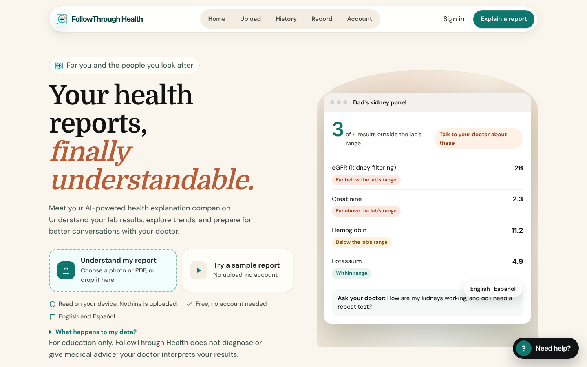
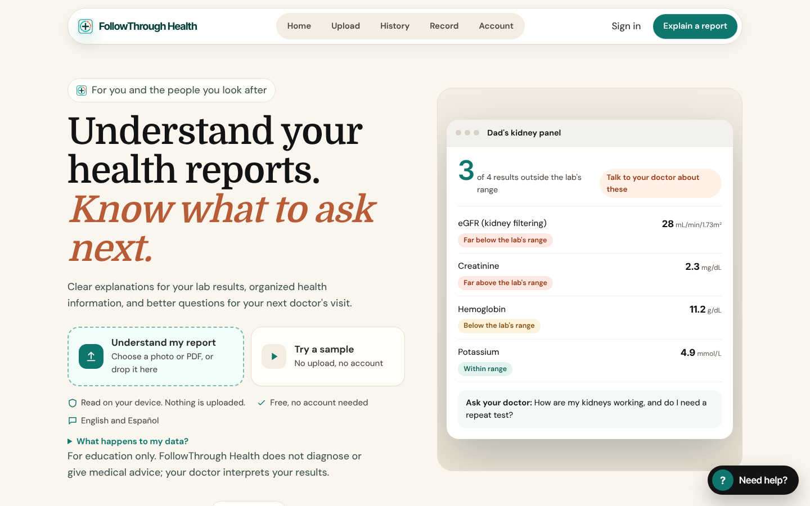
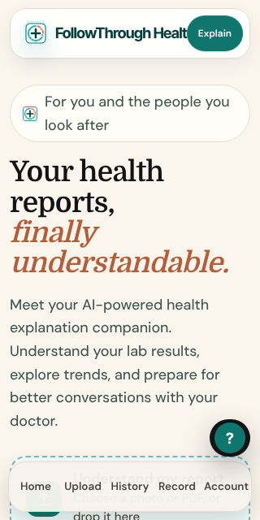
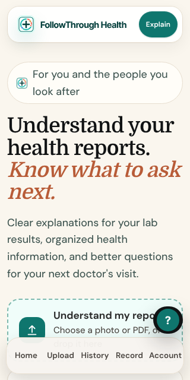
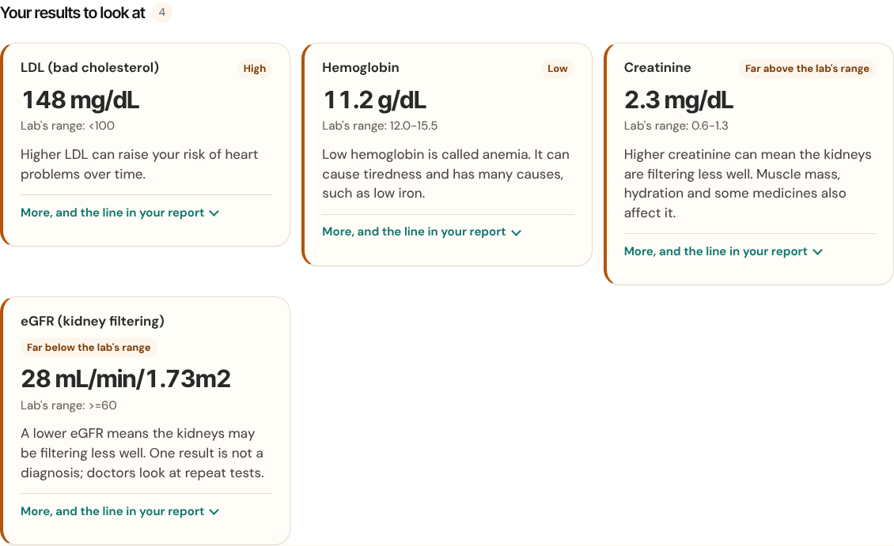
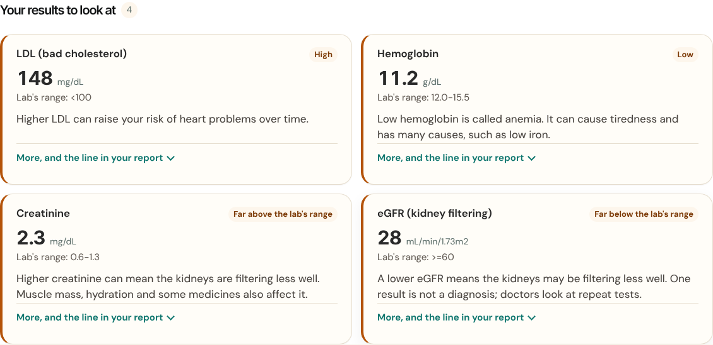
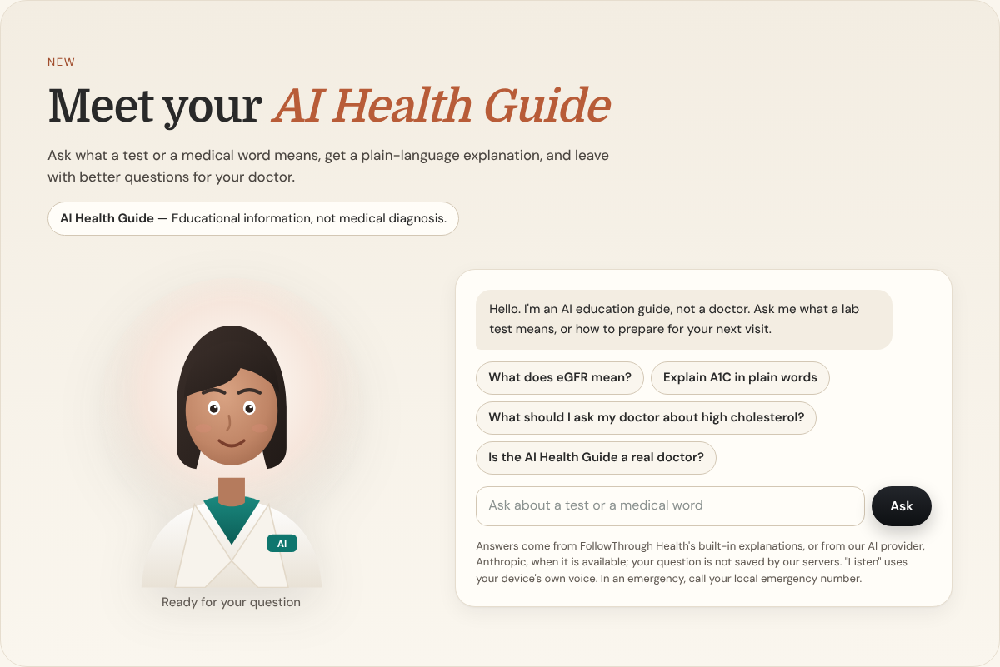
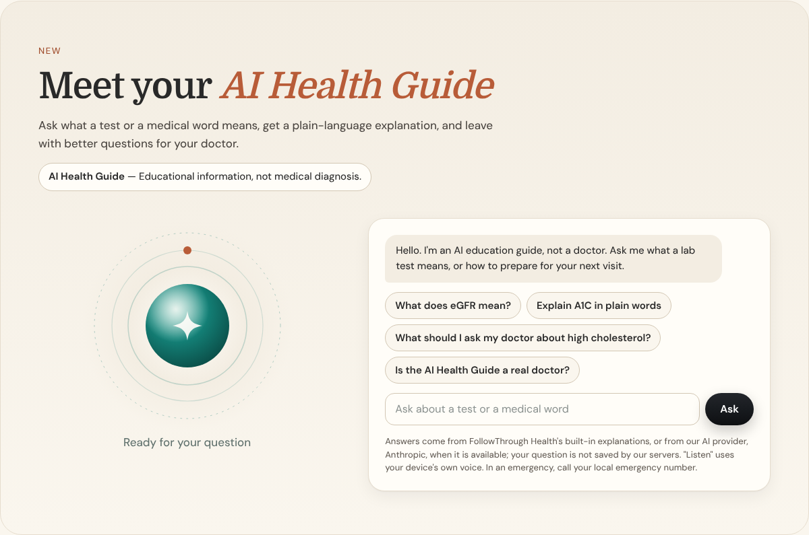

# Premium design quality review

Started 10 Nov 2026 in response to the owner's brief "World-class product design & implementation agent". The owner rejected the previous redesign's polish, not the product. This file records what was actually inspected, what is wrong, what was changed, and what is still open. It is updated on each design pass.

## How the inspection was done (and its limits)

- **The live site (followthroughhealth.com) could not be opened from the build container**: the network proxy refuses it. The audit used the local build of `main` at `7e85214`. That is the version deployed live: the Production Monitor confirms the live cache version matches `main`.
- Rendered in Chromium (Playwright) with the real fonts (DM Sans, Domine) at **1440, 1024, 768, 390 and 320 px**. Full-page captures were cut into screen-sized pieces and reviewed one by one.
- Reviewed: homepage (every section), navigation, upload, a synthetic report's results (9 tests: kidney, blood count, cholesterol and others), footer, pricing, FAQ, AI Health Guide section, DocBridge section.
- **Not yet inspected:** signed-in screens (History with saved reports, Trends, Reminders, Account signed in). These need a mocked account session and come in the next pass.
- In full-page captures the sticky header and bottom tab bar appear mid-page; that is a capture artifact, not a defect.
- No real-device testing has been done. No usability test with people has been run.

## What makes it feel unfinished (evidence)

The problem is consistency and editing, not missing features.

**1. Styles have been layered, not designed.** Measured in the two stylesheets (`styles.css` 170 KB, `ui.css` 90 KB):

| | styles.css | ui.css |
|---|---|---|
| `!important` overrides | 218 | 267 |
| Distinct hex colours | 255 | 70 |
| Distinct font sizes | 47 | 17 |
| Distinct box shadows | 54 | 12 |
| Distinct corner radii | 18 | 12 |

Three redesigns sit on top of each other. Different sections still use different palettes: an amber `#e3a35a` link colour on the dark band, teal and terracotta elsewhere, red `#b91c1c` on cards.

**2. The homepage tells the same story four or five times.** It is 12,000 px tall on desktop (about 13 screens) and 20,000 px on a phone (about 24 screens). The same creatinine/eGFR example appears in:
- the hero preview,
- the 6-step demo,
- "Every result in plain words",
- the "A report lands at 9 pm" card,
- the "How it works" mock-ups.

"Private / safe" is explained three times: Safe by design, Private by default, and the dark feature cards. The closing call to action was repeated word for word in the footer.

**3. Visual languages change from section to section.** The page goes from cream editorial panels to a near-black band with gradient cards and amber links, back to cream, then to a black CTA band. Some sections sat in rounded panels; three had only a left and right 1 px line with no top or bottom, which looked like an unfinished frame.

**4. Calls to action are inconsistent.** Eight different labels lead to the same upload ("Explain a report", "Understand my report", "Explain a report, free", "Add a report", "Start on this phone", "Try it yourself", "Start free", "Explain"), in four button styles (teal, dashed teal card, black pill, white pill).

**5. The AI Health Guide illustration** is a flat cartoon woman in a white coat with an "AI" badge. The white coat implies a physician, which conflicts with the "not a doctor" message beside it. It reads as clip art, not as a signature feature.

**6. Specific defects found:**

| # | Where | Defect | Status |
|---|---|---|---|
| D1 | Hero, 1440 px | A floating "English · Español" label covered the preview's "Ask your doctor" text | Fixed |
| D2 | Hero preview | Values shown without units (28, 2.3, 11.2, 4.9) | Fixed: units shown |
| D3 | Hero | Background ran an 18-second gradient animation forever (constant CPU, no purpose) | Fixed: static surface |
| D4 | Header, 320 px | "Explain" button covered the brand name ("FollowThrough Healt") | Fixed |
| D5 | Results, desktop | 4 cards in rows of 3 + 1, leaving two-thirds of a row empty; uneven heights | Fixed: 2 + 2, equal heights per row |
| D6 | Results | Unit as large as the number ("28 mL/min/1.73m2"); the value does not read first | Fixed: unit set smaller (same text) |
| D7 | Results | "More, and the line in your report" at different heights in one row | Fixed: aligned to the card bottom |
| D8 | Footer | Repeated the closing CTA headline and both buttons right under the CTA band | Fixed: footer is links only |
| D9 | Problems, Safety, Pricing, DocBridge sections | Side lines with no top or bottom | Fixed: removed |
| D10 | Dark band | Off-palette amber links | Fixed: ivory |
| D11 | Demo table, 390 px | Reference column cut off (table scrolled sideways) | Fixed at 390 px; at 320 px it still scrolls inside its card |
| D12 | Tablet, 768 px | Tab nav 8 px wider than its box | Open |
| D13 | Results | Accent bars are thick orange, with pill labels in two vocabularies ("High" vs "Far above the lab's range") | Bar reduced to 3 px. Labels unchanged: they come from the clinical rules and are not changed for design |
| D14 | Homepage | Duplicate sections and 8 CTA labels | Fixed in pass 2 (owner approved 10 Nov) |
| D15 | AI Health Guide | Cartoon physician illustration, with three looping animations even when idle | Fixed in pass 2: abstract companion (owner chose direction B) |

## Design direction

Premium editorial healthcare, calm and warm, with colour used sparingly:
- **Neutrals:** ivory `#FAF6EE`, cream `#F3EDE2` and white `#FFFDF8` for surfaces; charcoal `#292929` for text.
- **Accents:** deep teal `#0F766E` is the single action colour; terracotta `#B85C38` is only for emphasis in headlines and for "outside the range" accents.

Rules this pass started applying, to carry through the rest:
- **Numbers first:** results show the number large and the unit smaller, never rounded, never re-worded.
- **One frame per section:** a full rounded panel or no frame, never side lines alone.
- **No decoration over content:** floating labels and looping backgrounds are removed. Motion is kept only where it explains something (the 6-step demo) and is turned off under reduced motion.
- **Footers navigate; they do not sell again.**

### Homepage order (approved by the owner on 10 Nov; built in pass 2)

| Keep, in this order | Purpose |
|---|---|
| Hero with the real-looking preview | What it is, one primary action |
| 6-step "From a confusing line to a clear next step" demo | Problem → solution, shown not told |
| AI Health Guide | Signature feature |
| How it works (3 steps) | Short |
| Safe by design (does / never) | Trust |
| DocBridge | For clinics |
| Pricing | |
| FAQ | |
| Closing CTA | One ending |

**Merge or remove:**
- "Every result in plain words": duplicates the demo.
- "A report lands at 9 pm": duplicates the demo's message.
- "Private by default": duplicates Safe by design; move its links there.
- The 6 dark feature cards: fold the two unique ones, Caregiver mode and CT/MRI reports, into How it works.
- The secondary in-page tab row under the hero: duplicates the header.

One CTA label everywhere: **Understand my report** (primary) and **Try a sample** (secondary).

Expected effect: roughly 40% shorter. This changes another agent's recent work (#149, #151), so it waits for the owner's approval.

### AI Health Guide: two directions (prototypes are the next pass)

- **A. Stylised 3D guide.** A production-quality 3D character needs a commissioned or licensed asset (and probably Rive or WebGL). That is spending, so it needs the owner's approval. It will not be imitated with a cheap substitute.
- **B. Abstract companion.** A calm, non-human form (soft concentric light in teal and ivory) whose states are shown by slow, purposeful motion:
  - ready: still
  - thinking: a slow breath
  - explaining: a light that points to the highlighted result card
  - reading aloud: a gentle pulse tied to speech
  - error or offline: muted

  It is built with SVG and CSS, needs no new libraries, costs nothing and is light on phones. It cannot be mistaken for a doctor, which fits "AI Health Guide, not a doctor".

**The owner chose B on 10 Nov.** It is built in pass 2 (below). Direction A was not prototyped: it needs a commissioned or licensed asset and a budget.

## Changes in this pass (PR from `claude/carewise-api-project-jmxg7f`)

- **Hero:**
  - Headline "Understand your health reports. *Know what to ask next.*" with the owner's supporting sentence; CTAs "Understand my report" and "Try a sample".
  - Floating labels and the looping background removed; preview values shown with units.
- **Header at 320 px:** brand and button fit.
- **Results:**
  - Two even columns on wide screens with equal heights; numbers large and units smaller.
  - The "More" link is aligned within each row and the accent bar is thinner.
  - The value text is unchanged: Listen still reads "148 mg/dL".
- **Sections:** stray side lines removed; dark-band links in ivory.
- **Footer:** links only.
- **Demo table:** fits a 390 px phone.
- **Evals:**
  - New `scripts/eval/design-quality.mjs` (31 checks), added to Frontend CI. **On `main` it fails 9 checks; with this change all pass.**
  - `homepage.mjs` and the smoke test were updated for the new headline and footer.

### Screenshots (synthetic data)

| | Before (`main`) | After |
|---|---|---|
| Hero, 1440 px |  |  |
| Hero, 320 px |  |  |
| Results, 1440 px |  |  |

### Verification

- **Design quality gates:** 31/31 pass.
  - No sideways page scroll at 1440, 1024, 768, 390 and 320 px on Home or the results.
  - Exact value text on every card.
  - Results grid 2 + 2.
  - No looping hero animation.
- **Accessibility:** the axe-core scan (WCAG 2.0/2.1/2.2 A and AA) has 0 serious or critical and 0 moderate or minor findings across 42 screen and size combinations.
- **Every other Frontend CI eval passes:**
  - report accuracy (68 reports, 200 tests, 100%) and the 34 safety cases
  - smoke, CSP and the cache version check
- **Not measured yet:** performance (Lighthouse or Web Vitals). This is planned for the review sprint.

## Pass 2 (10 Nov): homepage story and AI Health Guide

### Homepage, as approved
- **Removed:**
  - the in-page tab row under the hero, which repeated the header
  - "Every result in plain words" (`#insights`), which repeated the demo
  - "A report lands at 9 pm"
  - "Private by default"
- **Moved:** the 1-minute tour button now sits in the demo's intro ("Take the 1-minute tour"), and the tour still starts.
- **Safe and private by design** has three columns: does, never, and **your data**. The data column lists only protections the product has: read on device, doctor links you can turn off, see, download or delete your data, help questions not saved. It links to the privacy policy, safety page and Your data.
- **Feature cards:** 6 → 4. "Private by design" was removed, and "Family record" and "Caregiver mode" were merged.
- **One main action label, "Understand my report",** in the header, hero, demo and closing band. **One sample label, "Try a sample".** Early access stays as a text link in the closing band.
- **Dead code removed:**
  - the tab script for the removed section
  - 53 CSS rules for removed sections and decorations
- **Header at 320 px:** the longer label needed tighter type below 340 px. The gate caught the overlap.
- **Measured length:** desktop 12,029 → 9,909 px (**−18%**); phone 20,156 → 16,204 px (**−20%**). This is less than the 40% estimate: the comparison table, DocBridge and the How it works mock-ups remain. Shortening those further is a candidate for the next pass.

### AI Health Guide: abstract companion
- **The figure:** a deep-teal core with soft ivory light, three fine orbit rings and one terracotta spark. No face and no coat. Its accessible name says it is "an abstract symbol … not a person".
- **States (also written in words under the figure):**
  - **Ready:** still. **Nothing animates while idle.** The old figure ran three looping animations all the time.
  - **Listening:** the rings brighten.
  - **Thinking:** the core breathes and the spark orbits.
  - **Answering:** a ripple moves outward.
  - **Reading aloud:** a slow pulse.
  - **Error** (new): muted and still. Shown when an answer fails; the text says "Couldn't answer just now".
  - **Offline** (new): muted and still. Shown when the browser is offline; the text says "Offline: using built-in explanations", which is true, because answers then come from the built-in explanations.
- **Reduced motion:** no movement in any state.
- **Chat:** the chip that wraps to two lines is now left-aligned like the others.
- **Self-critique applied:** the first version had an ECG line in the core. That is a clinical cliché that implies monitoring, so it was replaced with a soft spark.

| | Before | After |
|---|---|---|
| AI Health Guide, 1440 px |  |  |

### Not yet done for the guide
- **Explaining a report** (brief section 6): when the guide explains a result, highlight that result's card and show its exact value, unit, source line and doctor question. The guide's answers come from help.js and the server. This needs a design for linking an answer to a card, with tests that it never invents a source line.
- **Microphone input:** not started. It is a separate capability that needs permission handling and a provider review.

### Pass 2 verification
- **homepage.mjs** (45 checks), rewritten for the approved structure:
  - the sections appear in order, and the removed sections are gone
  - one label for each action, and the tour still starts
  - the trust section has three columns, links to the policies and makes no unsupported claims
  - the demo's explanation equals the app's own
  - axe is clean on the homepage sections
- **ai-guide.mjs**, with new checks:
  - the figure is not a person
  - nothing animates while idle; there is motion while thinking or answering
  - error and offline are still, and going offline is said in words
  - nothing moves with reduced motion, even while thinking
- **design-quality.mjs:** 33 checks. It now also checks that the guide's Ask button is not covered after scrolling to it, which was the CI failure on this PR's first push.
- **All Frontend CI evals pass locally:** report accuracy (68 reports, 100%), the 34 safety cases, the stress test, smoke, CSP and cache checks.
- **Accessibility:** the axe scan finds 0 issues across 42 screen and size combinations.

## Status by screen

| Screen | Status | Notes |
|---|---|---|
| Hero | VISUALLY VERIFIED | 1440 and 320 px screenshots; gates pass. Not yet FUNCTIONALLY VERIFIED on a real phone |
| Navigation | IN PROGRESS | 320 px fixed; 768 px tab nav overflow (D12) open |
| Report demonstration | IN PROGRESS | Table fits 390 px; 320 px scrolls inside its card. Tour button moved here |
| AI Health Guide | VISUALLY VERIFIED | Abstract companion and states built; report-explaining link to cards not started |
| Upload | NOT STARTED | Inspected; no changes yet |
| Results | VISUALLY VERIFIED | Grid, number and unit, alignment. Further: grouping header, summary meter review |
| Health history | NOT STARTED | Needs signed-in inspection |
| Trends | NOT STARTED | Must use saved values only |
| Reminders | NOT STARTED | |
| Doctor brief | NOT STARTED | |
| How it works / feature cards | VISUALLY VERIFIED | 4 cards; links fixed |
| FAQ | NOT STARTED | Inspected: accordions acceptable; styling to align |
| Pricing | IN PROGRESS | Side lines removed; prices unchanged (not to be changed) |
| Footer | VISUALLY VERIFIED | Duplicate CTA removed |
| Sign-in and account | NOT STARTED | |
| DocBridge section | IN PROGRESS | Frame fixed |
| Mobile app (React Native) | NOT STARTED | Sprint 5 |
| Trust and privacy | VISUALLY VERIFIED | Does / never / your data |

## Open asks for the owner

1. ~~Approve the homepage section plan~~: approved and built (pass 2).
2. ~~AI Health Guide direction~~: B chosen and built (pass 2).
3. Real-phone check of the hero, results and guide after merge.

## Next pass
1. Signed-in screens with a mocked account: History, Trends (saved values only), Reminders, Account.
2. Results: summary meter review, grouping headers, doctor brief layout.
3. AI Health Guide: link explanations to the matching result card (value, unit, source line, doctor question).
4. Consolidate the stylesheets: replace the remaining overrides with tokens, section by section, measured by the table at the top.
5. Performance baseline (Lighthouse or Web Vitals) before and after.
